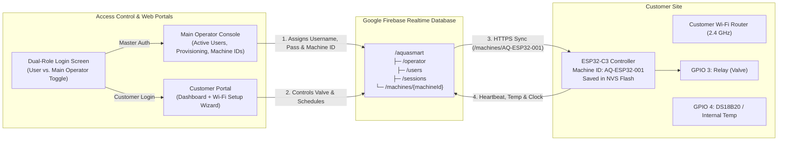

# AquaSmart Web — ESP32-C3 + Firebase Realtime Cloud Bridge

This guide documents the complete production architecture, hardware pinouts, Firebase Realtime Database schema, Dual-Role Authentication system, and customer onboarding flow for the **AquaSmart Irrigation Web Dashboard** using the **ESP32-C3** and **Google Firebase**.

---

## 1. System Architecture (100% Firebase — Unlimited Machines)

---

## 2. Firebase Realtime Database Schema (`/aquasmart`)

All user accounts, active sessions, and unlimited ESP32-C3 machines are stored under `/aquasmart` in your Firebase Realtime Database:

| Path | Purpose |
| :--- | :--- |
| `/aquasmart/operator` | Master Operator username and SHA-256 password hash |
| `/aquasmart/users/{username}` | Customer user record (`username`, `passwordHash`, `fullName`, `deviceName`, `machineId`) |
| `/aquasmart/sessions/{role_username}` | Live active session heartbeats across customer phones and browsers |
| `/aquasmart/machines/{machineId}/info` | Hardware metadata (`machineId`, `ip`, `lastSeenEpochMs`, `gmtOffsetSec`, `maxOpenMinutes`) |
| `/aquasmart/machines/{machineId}/state` | Live telemetry & control (`master`, `valve`, `temp`, `time`, `schedulesJson`, `terminalRx`, `terminalTx`) |

---

## 3. Hardware Pinout (ESP32-C3)

| Component | ESP32-C3 Pin | Mode | Notes |
| :--- | :---: | :---: | :--- |
| **Relay Module (Valve)** | **GPIO 3** | `OUTPUT` | Active HIGH (`1` = OPEN, `0` = CLOSED) with 120-min safety watchdog |
| **DS18B20 Temp Sensor** | **GPIO 4** | `INPUT_PULLUP` | Optional external sensor (auto-falls back to C3 internal sensor) |
| **Wi-Fi Reset Button** | **GPIO 9** | `INPUT_PULLUP` | Built-in `BOOT` button; hold for 5s to clear Wi-Fi & open `AquaSmart-Setup` |

---

## 4. End-to-End Commercial Customer Onboarding Workflow

1. **Operator Pre-Assigns Account & Machine ID**:
   - Log into the **Main Operator Console** (`admin` / your configured master password).
   - Under **Assign New Customer User & Hardware Unit**, enter the customer's username, password, full name, and **Machine ID** (e.g. `AQ-ESP32-002`).
   - Share the website URL, username, and password with the customer along with their hardware unit.
2. **Customer Logs Into the Website**:
   - The customer opens the website on their phone or laptop and signs in with their assigned username and password.
   - Because their new unit is not on Wi-Fi yet, the dashboard displays the **"📶 Connect Machine to Wi-Fi"** onboarding banner.
3. **Customer Establishes Initial Wi-Fi Connection**:
   - The customer plugs in their ESP32-C3 (which immediately broadcasts the **`AquaSmart-Setup`** Wi-Fi hotspot).
   - They connect their phone/laptop Wi-Fi to **`AquaSmart-Setup`** and tap **"Open Machine Setup Page (192.168.4.1)"** inside the website's Wi-Fi Setup Wizard.
   - The setup page automatically pre-fills their assigned `Machine ID` and `Firebase Database URL`! The customer simply enters their home 2.4 GHz Wi-Fi name and password and taps **Save & Connect Machine**.
4. **Worldwide Cloud Control**:
   - The ESP32-C3 connects to their home Wi-Fi and syncs with Firebase Cloud.
   - The customer's dashboard badge turns **`● ESP32-C3 ONLINE`**, and they can monitor and control their irrigation system from anywhere in the world.

---

## 5. Project Structure

| File | Purpose |
| :--- | :--- |
| [`web/index.html`](web/index.html) | Dual-Role Login Gateway, Operator Console, Customer Dashboard & Wi-Fi Setup Wizard Modal |
| [`web/css/styles.css`](web/css/styles.css) | Dark-theme stylesheet (`#0A1929` Navy900 & `#00BFA5` Teal500) |
| [`web/js/firebase-config.js`](web/js/firebase-config.js) | Central Firebase Realtime Database URL & project configuration |
| [`web/js/auth-manager.js`](web/js/auth-manager.js) | Firebase-synced dual-role authentication, SHA-256 hashing, user directory & live session tracker |
| [`web/js/blynk-client.js`](web/js/blynk-client.js) | Firebase Realtime Database REST client, per-machine state sync, schedules & UART terminal |
| [`web/js/app.js`](web/js/app.js) | Master UI controller binding Auth, Operator Console, Wi-Fi Wizard & Customer Dashboard |
| [`firmware/AquaSmart_ESP32C3/AquaSmart_ESP32C3.ino`](firmware/AquaSmart_ESP32C3/AquaSmart_ESP32C3.ino) | Universal ESP32-C3 Firebase firmware (Zero external libraries required, NVS schedules/clock, 2h safety watchdog, `AquaSmart-Setup` portal) |
| [`firebase.json`](firebase.json) & [`deploy.sh`](deploy.sh) | One-command free Firebase Hosting deployment |
